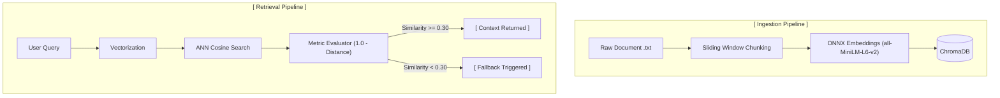
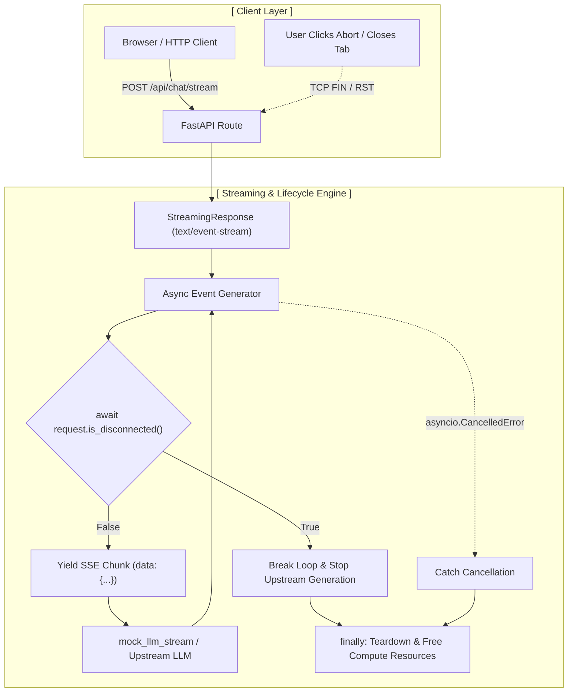

# AI Engineering Interview & Practice Portfolio

A curated collection of modular, production-pattern implementations for AI/ML engineering interviews and practical experimentation. Each sub-project focuses on a core concept—such as retrieval-augmented generation (RAG), vector storage mechanics, confidence gating, or evaluation loops.

## Production-Ready RAG Retrieval Pipeline with Confidence Guardrails
A modular, lightweight Retrieval-Augmented Generation (RAG) knowledge retrieval engine built in Python using ChromaDB. This project demonstrates semantic document indexing, sliding-window chunking, vector persistence, and a similarity-threshold fallback mechanism to prevent hallucinations on out-of-scope queries.

### Repository Structure
```text
.
├── rag_pipeline/                 # Semantic retrieval engine with confidence gating
│   ├── data/
│   │   └── policy.txt            # Sample domain knowledge base
│   ├── chroma_db/                # Persistent vector database (ChromaDB)
│   ├── config.py                 # Centralized environment & pipeline configuration
│   ├── chunking.py               # Token-aware sliding-window chunker
│   ├── indexer.py                # ChromaDB collection & upsert manager
│   ├── retriever.py              # Semantic search & fallback threshold logic
│   ├── main.py                   # End-to-end execution script
│   └── requirements.txt          # Python dependencies (chromadb, tiktoken, etc.)
│
├── .gitignore                    # Shared repository gitignore
└── README.md                     # Root project documentation (this file)
```

### Architecture Overview



### Features

- **Token-Aware Chunking**: Subword token-aware chunking (via `tiktoken`) with configurable chunk size and token overlap, ensuring chunk boundaries respect model token constraints.
- **Two-Stage Retrieval (Bi-Encoder + Cross-Encoder)**: Uses ChromaDB for fast candidate retrieval (high recall) and a Cross-Encoder reranker (`sentence-transformers`) for deep cross-attention semantic scoring (high precision).
- **Logit Calibration via Temperature Scaling**: Converts raw Cross-Encoder output logits into calibrated probabilities in the range [0, 1] using a temperature-scaled sigmoid function ($T = 2.0$).
- **Centralized Configuration**: All thresholds, model identifiers, chunking parameters, and vector DB paths are decoupled and managed via `config.py`.
- **Deterministic Ingestion**: Employs `collection.upsert()` with deterministic document IDs to prevent duplicate vectors and index bloat across re-runs.


### Why Confidence Guardrails Matter

Standard vector search (Approximate Nearest Neighbor / ANN) is inherently greedy—it unconditionally returns the top-$K$ nearest vectors even if the query is entirely out of domain. In a pure vector setup, querying *"How do I configure a Docker container?"* against a corporate travel policy database forces the engine to return the closest travel policy clause. Passing these low-relevance passages directly to a downstream LLM induces hallucination, context dilution, and prompt contamination.

While bi-encoder cosine distance can filter gross mismatches, it evaluates queries and documents independently into static vector embeddings, frequently producing false positives due to surface-level lexical overlap. 

By layering a **Cross-Encoder reranker** as an evaluation gate:
1. The query and candidate documents are processed simultaneously across full self-attention layers.
2. The model evaluates whether the candidate passage genuinely answers or satisfies the query.
3. If the calibrated score falls below the confidence cutoff (e.g., $\text{Score} < 0.30$), the system halts passage injection and triggers a fallback response instead of forwarding irrelevant context.


### Guardrailing Changes

The guardrailing mechanism transitions from static vector space distance checks to calibrated cross-encoder inference:

- **Scoring Paradigm Shift**:
  - *Previous Approach*: Depended on bi-encoder cosine distance inversion:
    $$\text{Similarity} = 1.0 - \text{Cosine Distance}$$
  - *Current Approach*: Evaluates joint `(query, document)` token pairs via `CrossEncoder.predict()` and maps output logits to a smooth probability using temperature-scaled sigmoid activation:
    $$\text{Calibrated Score} = \frac{1}{1 + e^{-\frac{\text{logit}}{T}}} \quad \text{where } T = 2.0$$

- **Role of Vector Search**: ChromaDB's vector similarity no longer makes the final acceptance or rejection decision. It serves exclusively as a high-recall candidate generator (top-$K$), handing off the top candidates to the reranker.

- **Explicit Fallback Path**: The pipeline compares the top candidate's calibrated score against `settings.CONFIDENCE_THRESHOLD`. If below the threshold, it suppresses the document context, sets the payload to `None`, and routes the interaction to a formal fallback message.


## Asynchronous SSE Streaming Service with Disconnect Detection
A high-throughput, resilient token streaming microservice built with FastAPI, Uvicorn, and Starlette `StreamingResponse`. This project demonstrates production-grade Server-Sent Events (SSE) streaming for LLMs, active TCP connection polling, task cancellation propagation, and resource cleanup guarantees to eliminate orphaned inference workloads.

### Repository Structure
```text
.
├── fastapi-sse-disconnect-lab/
|   ├── static/
|   │   └── index.html            # Fetch API client with AbortController UI
|   ├── mock_data.py              # Centralized token corpus, defaults & mock payloads
|   ├── mock_llm.py               # Async token generator simulating inference latency
|   ├── main.py                   # FastAPI app, SSE route & disconnect detection lifecycle
|   ├── client_test.py            # Automated httpx test harness simulating abrupt TCP drops
|   └── requirements.txt          # Service dependencies (fastapi, uvicorn, httpx)
│
├── .gitignore                    # Shared repository gitignore
└── README.md                     # Root project documentation (this file)
```

### Architecture Overview



### Features
- **Standardized Server-Sent Events (SSE)**: Streams text tokens wrapped in standard data: `{"token": "...", "index": N}\n\n` frames, terminating cleanly with an explicit data: `[DONE]\n\n` sentinel.

- **Dual-Layer Disconnect Detection**:
    - Proactive State Polling: Interrogates `await request.is_disconnected()` prior to producing each subsequent token, preventing unnecessary calls to upstream inference engines.
    - Reactive Task Cancellation: Traps `asyncio.CancelledError` raised when the ASGI server (Uvicorn) terminates the socket coroutine upon receiving a TCP RST/FIN packet.

- **Guaranteed Cleanup Semantics**: Encapsulates generator loops inside `try...finally` blocks to guarantee that upstream HTTP client sessions, database contexts, and GPU resources are promptly released.

- **Proxy-Aware Buffering Headers**: Includes `X-Accel-Buffering: no and Cache-Control: no-cache` response headers to prevent reverse proxies (e.g., NGINX, Cloudflare) from buffering chunks and delaying time-to-first-token (TTFT).

- **Separation of Concerns**: Decouples mock data corpora `(mock_data.py)` and simulated upstream generation `(mock_llm.py)` from the HTTP routing and lifecycle layer `(main.py)`.


### Why Client Disconnect Detection Matters?
In generative AI applications, inference is compute-bound, costly, and high-latency. Without active disconnect monitoring:

1. The Ghost Computation Problem: If a client navigates away, closes a mobile app, or clicks "Stop Generating", standard async generators continue executing until the completion of `max_tokens`.
2. Resource Exhaustion: Model servers (vLLM, Ollama, Triton) or billable third-party endpoints continue consuming compute and rate limits for outputs that no client will ever consume.
3. Connection Leaks: Background tasks left running without active consumer streams cause event-loop lag and gradual resource starvation.

Integrating `request.is_disconnected()` combined with asyncio.CancelledError interceptors ensures that compute termination occurs within a single token latency window of the client dropping the connection.


## Agent Tool Execution Registry & Guardrails
A secure, production-grade tool execution registry designed for autonomous AI agents. This repository enforces multi-layered runtime safety invariants—including strict argument schema validation, role-based permission scoping, deterministic idempotency checking, and indirect prompt injection defense.

### Repository Structure
```text
.
├── agent-tool-registry-lab/
|   ├── requirements.txt
|   ├── security/
|   │   ├── permissions.py       # RBAC & Scope enforcement
|   │   ├── idempotency.py       # Deterministic hashing & replay cache
|   │   └── injection_guard.py   # Heuristic detection & XML isolation
|   ├── tools/
|   │   ├── base.py              # BaseTool abstraction & JSON Schema exporter
|   │   └── implementations.py   # Sample tools (TransferFunds, FetchExternalDoc)
|   ├── registry.py              # Central execution pipeline orchestrator
|   ├── main.py                  # End-to-end attack and workflow simulations
|   └── tests/
|       └── test_registry.py     # Automated test suite
│
├── .gitignore                    # Shared repository gitignore
└── README.md                     # Root project documentation (this file)
```

### Architecture Overview
When an LLM agent issues a tool invocation request, passing arguments straight to an unvalidated function introduces severe attack surfaces (e.g., privilege escalation, state replay, untrusted instruction poisoning).
This registry interposes a strict, six-stage deterministic execution pipeline:

```text
[ LLM Agent Tool Call ]
           │
           ▼
┌─────────────────────────┐
│ 1. Permission Scoping   │ ──(Lacks Scope)──► [ PERMISSION_DENIED ]
└──────────┬──────────────┘
           │ (Allowed)
           ▼
┌─────────────────────────┐
│ 2. Schema Validation    │ ──(Malformed)────► [ VALIDATION_ERROR ]
└──────────┬──────────────┘
           │ (Valid)
           ▼
┌─────────────────────────┐
│ 3. Idempotency Check    │ ──(Cache Hit)────► [ SUCCESS_CACHED (Replay) ]
└──────────┬──────────────┘
           │ (Cache Miss)
           ▼
┌─────────────────────────┐
│ 4. Tool Execution       │ ──(Exception)────► [ EXECUTION_FAILURE ]
└──────────┬──────────────┘
           │ (Raw Output)
           ▼
┌─────────────────────────┐
│ 5. Save Idempotency     │
└──────────┬──────────────┘
           │
           ▼
┌─────────────────────────┐
│ 6. Injection Defense    │ ──► [ Heuristic Scan & XML Isolation Block ]
└──────────┬──────────────┘
           │
           ▼
[ Safe LLM Context Payload ]
```

### Core Security Invariants
1. Permission Scoping (RBAC)
Every registered tool declares an explicit operational requirement via Scope (READ, WRITE, FINANCIAL, ADMIN). Calls are intercepted before inspecting parameters or invoking logic. If the caller's SecurityContext lacks the prerequisite scope, the pipeline halts immediately with PERMISSION_DENIED.
2. Pydantic Argument Validation
Tools define parameter schemas using Pydantic BaseModel classes with explicit constraints (e.g., regex patterns, positive numeric bounds, default enums). In addition to runtime validation, schemas can be exported as standard JSON Schemas compatible with OpenAI, Anthropic, and Gemini function calling interfaces.
3. Deterministic Idempotency Guard
Non-idempotent operations risk severe side-effects when an agent enters retry loops. The idempotency manager:
- Canonicalizes arguments via `json.dumps(payload, sort_keys=True)`.
- Hashes `(tool_name:user_id:canonical_payload) using SHA-256`.
- Checks an in-memory TTL store. If found, it bypasses downstream execution and replays the cached result `(SUCCESS_CACHED)`.
4. Indirect Prompt Injection Defense
Data retrieved from third-party APIs, web scraping, or ticket systems may contain adversarial instructions designed to hijack upstream model attention.
- **Pattern Matching**: Inspects untrusted tool outputs against heuristic regex signatures (e.g., ignore previous instructions, system: you are now).
- **Semantic XML Encapsulation**: Neutralizes markdown code fences and special tokens `(<|im_start|>)`, encapsulating untrusted content inside `<untrusted_tool_data>` boundary tags so system prompts treat it as passive data rather than instructions.
