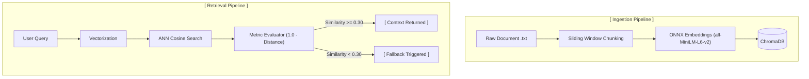

# AI Engineering Interview & Practice Portfolio

A curated collection of modular, production-pattern implementations for AI/ML engineering interviews and practical experimentation. Each sub-project focuses on a core concept—such as retrieval-augmented generation (RAG), vector storage mechanics, confidence gating, or evaluation loops.

## Production-Ready RAG Retrieval Pipeline with Confidence Guardrails
A modular, lightweight Retrieval-Augmented Generation (RAG) knowledge retrieval engine built in Python using ChromaDB. This project demonstrates semantic document indexing, sliding-window chunking, vector persistence, and a similarity-threshold fallback mechanism to prevent hallucinations on out-of-scope queries.

### Repository Structure
```text
.
├── rag_pipeline/                 # Semantic retrieval engine with confidence gating
│   ├── data/
│   │   └── policy.txt            # Sample domain knowledge base
│   ├── chroma_db/                # Persistent vector database (ChromaDB)
│   ├── chunking.py               # Sliding-window text chunker
│   ├── indexer.py                # ChromaDB collection & upsert manager
│   ├── retriever.py              # Semantic search & fallback threshold logic
│   ├── main.py                   # End-to-end execution script
│   └── requirements.txt          # Python dependencies for rag_pipeline
│
├── .gitignore                    # Shared repository gitignore
└── README.md                     # Root project documentation (this file)
```

### Architecture Overview



### Features

- Sliding-Window Chunking: Word-based chunking with configurable window and overlap sizes, ensuring boundary contexts are preserved without token truncation.
- Local Dense Embeddings: Employs ChromaDB's default ONNX runtime (all-MiniLM-L6-v2) generating 384-dimensional dense vectors locally—no external API keys required.
- Idempotent Ingestion: Uses collection.upsert() with deterministic IDs to avoid index bloat and duplicate entries across re-runs.
- Cosine Space Metric: Vector collection explicitly mapped to cosine space (hnsw:space: cosine), ensuring predictable similarity bounds.
- Confidence Guardrail Gate: Calculates semantic similarity ($1.0 - \text{distance}$) and routes low-confidence or irrelevant queries to a fallback path rather than blindly returning irrelevant passages.


### Why Confidence Guardrails Matter

Standard vector databases employ Approximate Nearest Neighbor (ANN) search, which is greedy—it will return the closest match regardless of relevance.
For instance, querying "How do I configure Docker container?" against a corporate travel policy database will still return the closest travel policy clause if unmoderated. By computing:
$$\text{Similarity} = 1.0 - \text{Cosine Distance}$$
and gating on threshold = 0.30, the system rejects the match ($0.009 < 0.30$) and issues a fallback routing message, safeguarding downstream LLMs from hallucination and prompt contamination.
