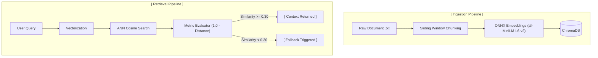

# AI Engineering Interview & Practice Portfolio

A curated collection of modular, production-pattern implementations for AI/ML engineering interviews and practical experimentation. Each sub-project focuses on a core concept—such as retrieval-augmented generation (RAG), vector storage mechanics, confidence gating, or evaluation loops.

## Production-Ready RAG Retrieval Pipeline with Confidence Guardrails
A modular, lightweight Retrieval-Augmented Generation (RAG) knowledge retrieval engine built in Python using ChromaDB. This project demonstrates semantic document indexing, sliding-window chunking, vector persistence, and a similarity-threshold fallback mechanism to prevent hallucinations on out-of-scope queries.

### Repository Structure
```text
.
├── rag_pipeline/                 # Semantic retrieval engine with confidence gating
│   ├── data/
│   │   └── policy.txt            # Sample domain knowledge base
│   ├── chroma_db/                # Persistent vector database (ChromaDB)
│   ├── config.py                 # Centralized environment & pipeline configuration
│   ├── chunking.py               # Token-aware sliding-window chunker
│   ├── indexer.py                # ChromaDB collection & upsert manager
│   ├── retriever.py              # Semantic search & fallback threshold logic
│   ├── main.py                   # End-to-end execution script
│   └── requirements.txt          # Python dependencies (chromadb, tiktoken, etc.)
│
├── .gitignore                    # Shared repository gitignore
└── README.md                     # Root project documentation (this file)
```

### Architecture Overview



### Features

- **Token-Aware Chunking**: Subword token-aware chunking (via `tiktoken`) with configurable chunk size and token overlap, ensuring chunk boundaries respect model token constraints.
- **Two-Stage Retrieval (Bi-Encoder + Cross-Encoder)**: Uses ChromaDB for fast candidate retrieval (high recall) and a Cross-Encoder reranker (`sentence-transformers`) for deep cross-attention semantic scoring (high precision).
- **Logit Calibration via Temperature Scaling**: Converts raw Cross-Encoder output logits into calibrated probabilities in the range [0, 1] using a temperature-scaled sigmoid function ($T = 2.0$).
- **Centralized Configuration**: All thresholds, model identifiers, chunking parameters, and vector DB paths are decoupled and managed via `config.py`.
- **Deterministic Ingestion**: Employs `collection.upsert()` with deterministic document IDs to prevent duplicate vectors and index bloat across re-runs.


### Why Confidence Guardrails Matter

Standard vector search (Approximate Nearest Neighbor / ANN) is inherently greedy—it unconditionally returns the top-$K$ nearest vectors even if the query is entirely out of domain. In a pure vector setup, querying *"How do I configure a Docker container?"* against a corporate travel policy database forces the engine to return the closest travel policy clause. Passing these low-relevance passages directly to a downstream LLM induces hallucination, context dilution, and prompt contamination.

While bi-encoder cosine distance can filter gross mismatches, it evaluates queries and documents independently into static vector embeddings, frequently producing false positives due to surface-level lexical overlap. 

By layering a **Cross-Encoder reranker** as an evaluation gate:
1. The query and candidate documents are processed simultaneously across full self-attention layers.
2. The model evaluates whether the candidate passage genuinely answers or satisfies the query.
3. If the calibrated score falls below the confidence cutoff (e.g., $\text{Score} < 0.30$), the system halts passage injection and triggers a fallback response instead of forwarding irrelevant context.


### Guardrailing Changes

The guardrailing mechanism transitions from static vector space distance checks to calibrated cross-encoder inference:

- **Scoring Paradigm Shift**:
  - *Previous Approach*: Depended on bi-encoder cosine distance inversion:
    $$\text{Similarity} = 1.0 - \text{Cosine Distance}$$
  - *Current Approach*: Evaluates joint `(query, document)` token pairs via `CrossEncoder.predict()` and maps output logits to a smooth probability using temperature-scaled sigmoid activation:
    $$\text{Calibrated Score} = \frac{1}{1 + e^{-\frac{\text{logit}}{T}}} \quad \text{where } T = 2.0$$

- **Role of Vector Search**: ChromaDB's vector similarity no longer makes the final acceptance or rejection decision. It serves exclusively as a high-recall candidate generator (top-$K$), handing off the top candidates to the reranker.

- **Explicit Fallback Path**: The pipeline compares the top candidate's calibrated score against `settings.CONFIDENCE_THRESHOLD`. If below the threshold, it suppresses the document context, sets the payload to `None`, and routes the interaction to a formal fallback message.
